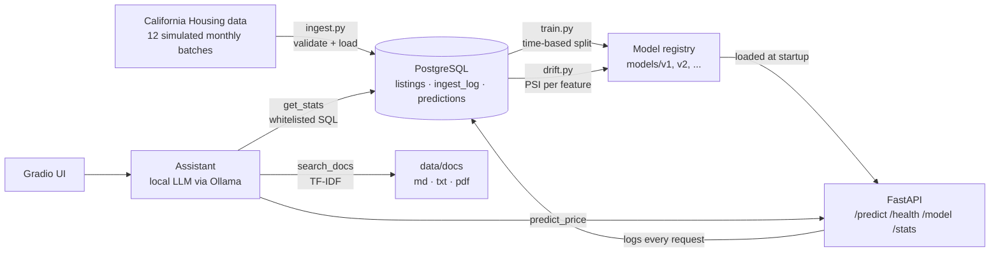

# 🏠 Housing Platform

**An end-to-end machine-learning system: scheduled SQL ingest → versioned model training → drift monitoring → prediction API → tool-using AI assistant.**

A small data platform that takes housing data from raw batches to a usable product. Data is loaded into PostgreSQL on a schedule, a price-prediction model is trained and versioned, new data is checked for drift, and predictions are served through an API that logs every request. An AI assistant answers questions by choosing between document search, pre-written SQL queries and the prediction API.

---

## Demo

**Assistant UI**

   
  <b>Figure 1.</b> Assistant UI (Gradio)

- **Question:** the input box for a plain-English question
- **Submit / Clear:** send the question or reset the page
- **Answer:** the assistant's final answer
- **Tools used:** which tool the assistant called and with what arguments, so its behaviour is visible

**Demo video** (silent, about 2 minutes): [Housing_predictor.zip](https://github.com/user-attachments/files/35228934/Housing_predictor.zip)

The recording shows the API docs page returning a price and usage statistics, then the assistant answering a database question, a price question, and a question with missing details (it asks for the details instead of guessing), followed by the automated tests.

---

## Architecture

---

## Tech stack

| Area | Technologies |
|---|---|
| Language | Python |
| Data and database | PostgreSQL, psycopg 3, SQL (constraints, indexes, JSONB, aggregates), pandas, NumPy |
| Machine learning | scikit-learn (gradient-boosted trees, TF-IDF), joblib |
| API | FastAPI, Pydantic, Uvicorn |
| LLM and assistant | Ollama (local LLM), Qwen2.5, OpenAI-compatible chat API, Gradio, pypdf |
| DevOps | Docker, Docker Compose, GitHub Actions |
| Testing and quality | pytest, ruff, httpx |
| Automation and config | PowerShell, Windows Task Scheduler, bash and .bat scripts, python-dotenv, YAML |

---

## Concepts applied
**Data engineering**
- ETL pipeline: extract, validate, load
- Idempotent batch loads and all-or-nothing database transactions
- Validation rules plus database constraints
- Scheduled jobs with exit codes and log files

**Machine learning**
- Gradient-boosted trees for price prediction
- Time-based train/test split, so the model is scored on data it has not seen
- Comparison against a naive baseline, error measured with MAE
- Versioned model registry

**MLOps and monitoring**
- Data drift detection with the Population Stability Index (PSI)
- Request logging, usage and latency statistics (average and p95), health checks
- Model hot-reload without restarting the API

**Backend**
- REST API design with typed input validation
- Failures in logging never break serving

**LLM engineering**
- Tool calling through a JSON protocol and an agent loop with a step limit
- Document retrieval with TF-IDF over Markdown, text and PDF files
- Pre-written SQL only, so the model never writes queries
- Guardrails against invented inputs
- Evaluation on a labelled question set, measuring tool-choice accuracy

**Software engineering**
- Unit, database integration and API tests
- Test doubles: a fake web server and a scripted fake LLM
- Linting, containers and continuous integration

---

## Data
California Housing (1990 U.S. census), loaded through `sklearn.datasets.fetch_california_housing`. Original source: Pace, R. K. and Barry, R., *Sparse Spatial Autoregressions*, Statistics and Probability Letters, 33 (1997).
